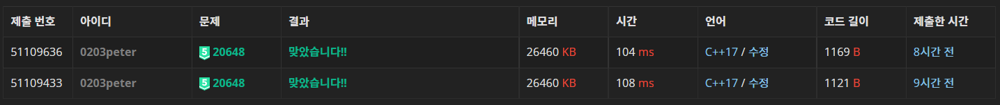

USACO 문제 너무 어렵다..

[https://www.acmicpc.net/problem/20648](https://www.acmicpc.net/problem/20648)

[20648번: Rectangular Pasture](https://www.acmicpc.net/problem/20648)



풀이

일반적인 2차원 누적합을 진행해준다 (소가 있는 위치를 1로 표시)

모든 i, j 쌍 (i &lt; j && i >= 0 && j &lt; n)에 대해 높이를 해당 위치에 맞추었을 때 얻을 수 있는 가짓수를 전체 정답에 더해준다.

좌표 압축하는 흐름이나 전체적인 아이디어를 잘 기억해야 할 문제라고 생각한다.

시간 복잡도 : $O(N^2)$

소요 시간 : 측정 불가

아쉬운 점 : 제대로 아이디어를 떠올리지 못했다

전체적인 감상 : 더 많은 USACO 연습이 필요함을 느꼈다.

```cpp
#include<bits/stdc++.h>
using namespace std;
#define pb push_back
typedef const int ci;
typedef long long ll;
typedef pair<int,int> pii;

int n, a, b, psum[2501][2501];
vector<pii> vc;

bool cmp2(pii l, pii r){
    return l.second < r.second;
}
ll ad(int xf, int yf, int xs, int ys){
    return psum[xs+1][ys+1]-psum[xs+1][yf]-psum[xf][ys+1]+psum[xf][yf];
}
int main(){
   cin>>n;
   for(int i=0;i<n;i++){
       cin>>a>>b;
       vc.pb({a, b});
   }
   sort(vc.begin(), vc.end());
   for(int i=0;i<n;i++){
       vc[i].first = i+1;
   }
   sort(vc.begin(), vc.end(), cmp2);
   for(int i=0;i<n;i++){
       vc[i].second = i+1;
   }
   for(pii pd : vc) psum[pd.first][pd.second] = 1;
   for(int i=1;i<=n;i++){
       for(int j=1;j<=n;j++){
           psum[i][j] += psum[i-1][j]+psum[i][j-1]-psum[i-1][j-1];
       }
   }
   ll ans = 1; // empty set
   for(int i=0;i<n;i++){
       for(int j=i;j<n;j++){ // when height is fixed to i and j
           int x1 = min(vc[i].first, vc[j].first)-1;
           int x2 = max(vc[i].first, vc[j].first)-1;
           ll f = ad(0,i,x1,j) * ad(x2,i,n-1,j);
           assert(f != 0);
           ans += f;
       }
   }
   cout<<ans;
}
```
