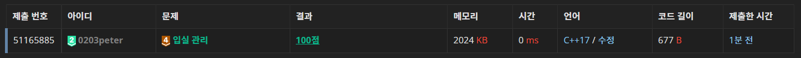

[https://www.acmicpc.net/problem/5524](https://www.acmicpc.net/problem/5524)

[5524번: 입실 관리](https://www.acmicpc.net/problem/5524)



풀이

입력에 대해 문자열을 하나하나 탐색해주며 대문자면 소문자로 변환 후 출력 소문자면 그대로 출력의 과정을 반복해준다

시간 복잡도 : $O(N\*20)$

```cpp
/* basic setup {{{ */
#include<bits/stdc++.h>
#define ff first
#define ss second
#define pb push_back
#define sz(x) ((int)x.size())
#define all(x) x.begin(),x.end()
#define compress(x) sort(all(x)), x.erase(unique(all(x)), x.end())
#define fast_io ios_base::sync_with_stdio(0),cin.tie(0),cout.tie(0)
using namespace std;
typedef long long ll;
typedef pair<int,int> pii;
typedef pair<ll,ll> pll;
typedef const int ci;
const int MOD = 1e9+7;
const int INF = 0x3f3f3f3f;
const ll LINF = 0x3f3f3f3f3f3f3f3f;
/*}}}*/

int main(){
	fast_io;
	int n;
	string s1;
	cin>>n;
	while(n--){
		cin>>s1;
		for(char c : s1)
			cout<<(char)(c>='a'?c:(c-'A'+'a'));
		cout<<'\n';
	}
	cout<<'\n';
}
```
