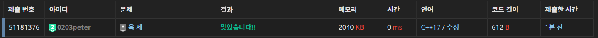

할 일이 조금 있다

[https://www.acmicpc.net/problem/17356](https://www.acmicpc.net/problem/17356)

[17356번: 욱 제](https://www.acmicpc.net/problem/17356)



풀이

문제의 수식을 그대로 적어주면 된다. 상대오차 $10^{-4}$이하로 맞추면 되어서 크게 어렵지 않다.

시간 복잡도 : $O(1)$

```cpp
/* basic setup {{{ */
#include<bits/stdc++.h>
#define ff first
#define ss second
#define pb push_back
#define sz(x) ((int)x.size())
#define all(x) x.begin(),x.end()
#define compress(x) sort(all(x)), x.erase(unique(all(x)), x.end())
#define fast_io ios_base::sync_with_stdio(0),cin.tie(0),cout.tie(0)
using namespace std;
typedef long long ll;
typedef pair<int,int> pii;
typedef pair<ll,ll> pll;
typedef const int ci;
const int MOD = 1e9+7;
const int INF = 0x3f3f3f3f;
const ll LINF = 0x3f3f3f3f3f3f3f3f;
/*}}}*/
long double a, b;
int main(){
	fast_io;
	cin>>a>>b;
	cout<<(1/(1+pow(10,(b-a)/400)));
	cout<<'\n';
}
```
