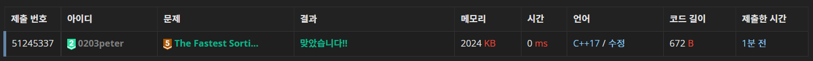

오늘 산학협력 expo 참가팀 drice로 참가했는데 너무 재미있었다.

[https://www.acmicpc.net/problem/23235](https://www.acmicpc.net/problem/23235)

[23235번: The Fastest Sorting Algorithm In The World](https://www.acmicpc.net/problem/23235)



풀이

입력, 출력만 보면 풀 수 있는 문제이다. 얼마나 코드를 줄일 수 있는지 고민해 보는 것도 좋은 것 같다.

시간 복잡도 : $O(T)$

소요 시간 : 20초

아쉬운 점 : 요즘 알고리즘에 나태해진 것 같다.

전체적인 감상 : 여러 가지로 점검할 필요가 있는 것 같다.

```cpp
/* basic setup {{{ */
#include<bits/stdc++.h>
#define ff first
#define ss second
#define pb push_back
#define sz(x) ((int)x.size())
#define all(x) x.begin(),x.end()
#define compress(x) sort(all(x)), x.erase(unique(all(x)), x.end())
#define fast_io ios_base::sync_with_stdio(0),cin.tie(0),cout.tie(0)
using namespace std;
typedef long long ll;
typedef pair<int,int> pii;
typedef pair<ll,ll> pll;
typedef const int ci;
const int MOD = 1e9+7;
const int INF = 0x3f3f3f3f;
const ll LINF = 0x3f3f3f3f3f3f3f3f;
/*}}}*/

int main(){
	fast_io;
	string s1;
	int n;
	int i = 0;
	while(cin>>n){
		if(!n) return 0;
		getline(cin, s1);
		cout<<"Case "<<++i<<": Sorting... done!\n";
	}
}
```
