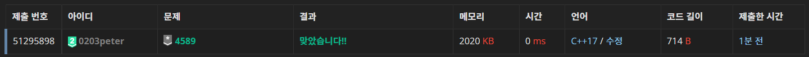

산학협력 expo 이틀 차다 이제 내일 하루 남았다.... 힘내자

[https://www.acmicpc.net/problem/4589](https://www.acmicpc.net/problem/4589)

[4589번: Gnome Sequencing](https://www.acmicpc.net/problem/4589)



풀이

if, else로 풀게되는 문제이다.

시간 복잡도 : $O(N)$

소요 시간 : 1분

아쉬운 점 : 힘내자

전체적인 감상 : 1년 전의 내가 이 문제를 보았다면 똑같은 코드를 짰을지 궁금해진다.

```cpp
/* basic setup {{{ */
#include<bits/stdc++.h>
#define ff first
#define ss second
#define pb push_back
#define sz(x) ((int)x.size())
#define all(x) x.begin(),x.end()
#define compress(x) sort(all(x)), x.erase(unique(all(x)), x.end())
#define fast_io ios_base::sync_with_stdio(0),cin.tie(0),cout.tie(0)
using namespace std;
typedef long long ll;
typedef pair<int,int> pii;
typedef pair<ll,ll> pll;
typedef const int ci;
const int MOD = 1e9+7;
const int INF = 0x3f3f3f3f;
const ll LINF = 0x3f3f3f3f3f3f3f3f;
/*}}}*/

int main(){
	fast_io;
	int n, a, b, c;

	cin>>n;
	cout<<"Gnomes:\n";
	while(n--){
		cin>>a>>b>>c;
		if((a < b && b < c) || (a > b && b > c)){
			cout<<"Ordered\n";
		}
		else cout<<"Unordered\n";
	}

}
```
