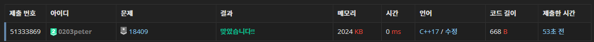

산학협력 expo 모두 마무리 되었다 결과는 인기상 행복하다

[https://www.acmicpc.net/problem/18409](https://www.acmicpc.net/problem/18409)

[18409번: 母音を数える (Counting Vowels)](https://www.acmicpc.net/problem/18409)



풀이

문자열의 문자 하나 하나를 탐색하며 모음이라면 출력값에 1을 더해준다

시간 복잡도 : $O(N)$

소요 시간 : 1분

아쉬운 점 : 앞으로 또 힘내자

전체적인 감상 : 화이팅

```cpp
/* basic setup {{{ */
#include<bits/stdc++.h>
#define ff first
#define ss second
#define pb push_back
#define sz(x) ((int)x.size())
#define all(x) x.begin(),x.end()
#define compress(x) sort(all(x)), x.erase(unique(all(x)), x.end())
#define fast_io ios_base::sync_with_stdio(0),cin.tie(0),cout.tie(0)
using namespace std;
typedef long long ll;
typedef pair<int,int> pii;
typedef pair<ll,ll> pll;
typedef const int ci;
const int MOD = 1e9+7;
const int INF = 0x3f3f3f3f;
const ll LINF = 0x3f3f3f3f3f3f3f3f;
/*}}}*/

int main(){
	fast_io;
	int n;
	string s1;
	cin>>n>>s1;
	n = 0;
	for(char c : s1) if(c == 'a'||c=='e'||c=='i'||c=='o'||c=='u') n++;
	cout<<n;
	cout<<'\n';
}
```
