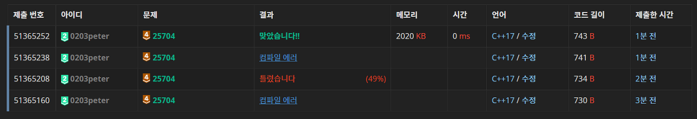

다시 알고리즘도 시작해야할 때가 되었다. KSEF와 함께...

[https://www.acmicpc.net/problem/25704](https://www.acmicpc.net/problem/25704)

[25704번: 출석 이벤트](https://www.acmicpc.net/problem/25704)



풀이

조건문을 잘 작성해주면 된다. max, min stl의 자료형 비교에 주의하자

시간 복잡도 : $O(1)$

소요 시간 : 5분

아쉬운 점 : 피곤하다

전체적인 감상 : 너무 바쁘다

```cpp
/* basic setup {{{ */
#include<bits/stdc++.h>
#define ff first
#define ss second
#define pb push_back
#define sz(x) ((int)x.size())
#define all(x) x.begin(),x.end()
#define compress(x) sort(all(x)), x.erase(unique(all(x)), x.end())
#define fast_io ios_base::sync_with_stdio(0),cin.tie(0),cout.tie(0)
using namespace std;
typedef long long ll;
typedef pair<int,int> pii;
typedef pair<ll,ll> pll;
typedef const int ci;
const int MOD = 1e9+7;
const int INF = 0x3f3f3f3f;
const ll LINF = 0x3f3f3f3f3f3f3f3f;
/*}}}*/

int main(){
	fast_io;
	double n, a;
	cin>>n>>a;
	double mn = a;
	if(n >= 20) mn=min(mn,a*0.75);
	else if(n>=10) mn=min(mn,a*0.9);

	if(n >= 15) mn=min(mn,a-2000);
	else if(n>=5) mn=min(mn,a-500);
	cout<<max(0.0,mn);
	cout<<'\n';
}
```
