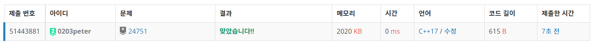

피곤하다

[https://www.acmicpc.net/problem/24751](https://www.acmicpc.net/problem/24751)

[24751번: Betting](https://www.acmicpc.net/problem/24751)



풀이

문제에서 주어지는 수식을 상대오차에 맞게 출력해준다

시간 복잡도 : $O(1)$

소요 시간 : 1분

아쉬운 점 : 없다

전체적인 감상 : 없다

```cpp
/* basic setup {{{ */
#include<bits/stdc++.h>
#define ff first
#define ss second
#define pb push_back
#define sz(x) ((int)x.size())
#define all(x) x.begin(),x.end()
#define compress(x) sort(all(x)), x.erase(unique(all(x)), x.end())
#define fast_io ios_base::sync_with_stdio(0),cin.tie(0),cout.tie(0)
using namespace std;
typedef long long ll;
typedef pair<int,int> pii;
typedef pair<ll,ll> pll;
typedef const int ci;
const int MOD = 1e9+7;
const int INF = 0x3f3f3f3f;
const ll LINF = 0x3f3f3f3f3f3f3f3f;
/*}}}*/

int main(){
	double a;
	cin>>a;
	cout<<fixed;
	cout.precision(10);
	cout<<100/a<<'\n'<<100/(100-a);
}
```
