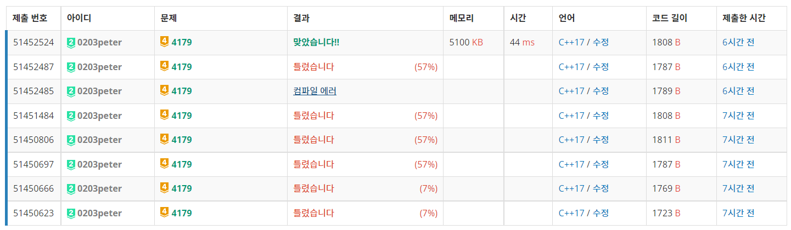

오랜만의 BFS 기본 문제 풀이였다.

[https://www.acmicpc.net/problem/4179](https://www.acmicpc.net/problem/4179)

[4179번: 불!](https://www.acmicpc.net/problem/4179)



불을 관리하는 queue, 가능 이동 경로를 관리하는 queue를 따로 관리해준다.

1초가 지날 때마다 불을 먼저 확산시켜주고 인간의 이동경로를 고려한다.

불이 퍼진 곳, 인간이 이동해왔던 곳을 fchk, chk 배열로 관리해준다.

\+ 맞왜틀이 두 개 있었다.

1\. inrange 함수 구현 미스 ($p &lt; n, q &lt; m$이 들어가야 하는걸 $p &lt; n, q &lt; n$으로 작성했다)

2, 불보다 인간 먼저 이동 (만약 같은 시간에 인간과 불이 같은 지점에 가야한다면 인간은 죽을까 살까? 죽을 것이다. 따라서 큰 while문에서 인간의 이동이 아닌 불의 이동을 먼저 구현해주어야 한다)

시간 복잡도 : $O(NM)$

소요 시간 : 35분

아쉬운 점 : 맞왜틀을 많이 했다.

전체적인 감상 : USACO 준비 이번 주말에 제대로 해보자.

```cpp
/* basic setup {{{ */
#include<bits/stdc++.h>
#define ff first
#define ss second
#define pb push_back
#define sz(x) ((int)x.size())
#define all(x) x.begin(),x.end()
#define compress(x) sort(all(x)), x.erase(unique(all(x)), x.end())
#define fast_io ios_base::sync_with_stdio(0),cin.tie(0),cout.tie(0)
using namespace std;
typedef long long ll;
typedef pair<int,int> pii;
typedef pair<ll,ll> pll;
typedef const int ci;
const int MOD = 1e9+7;
const int INF = 0x3f3f3f3f;
const ll LINF = 0x3f3f3f3f3f3f3f3f;
/*}}}*/
ci BN = 1001;
int n, m, dx[] = {-1, 1, 0, 0}, dy[] = {0, 0, -1, 1};
char c[BN][BN];
bool chk[BN][BN], fchk[BN][BN];
bool inrange(int p, int q){
	return p >= 0 && p < n && q >= 0 && q < m;
}
int main(){
	fast_io;
	cin>>n>>m;
	queue<pii> fire;
	queue<pii> jh;

	for(int i=0;i<n;i++){
		for(int j=0;j<m;j++){
			cin>>c[i][j];
			if(c[i][j] == 'J'){
				jh.push({i,j});
				chk[i][j] = 1;
			}
			else if(c[i][j] == 'F'){
				fire.push({i,j});
				fchk[i][j] = 1;
			}
		}
	}

	int pt = 0;

	queue<pii> tmp;
	while(1){
		pt++;
		while(!fire.empty()){
			pii fr = fire.front();
			fire.pop();
			for(int i=0;i<4;i++){
				int cx = fr.ff + dx[i], cy = fr.ss + dy[i];
				if(inrange(cx, cy)){
					if(!fchk[cx][cy] && c[cx][cy] != '#'){
						fchk[cx][cy] = 1;
						tmp.push({cx,cy});
					}
				}
			}
		}
		fire = tmp;
		tmp = queue<pii>();

		bool fd = 1;
		while(!jh.empty()){
			pii fr = jh.front();
			jh.pop();
			for(int i=0;i<4;i++){
				int cx = fr.ff + dx[i], cy = fr.ss + dy[i];
				if(inrange(cx, cy)){
					if(!chk[cx][cy] && !fchk[cx][cy] && c[cx][cy] != '#'){
						chk[cx][cy] = 1;
						tmp.push({cx, cy});
						fd = 0;
					}
				}
				else{
					cout<<pt<<'\n';
					return 0;
				}
			}
		}
		if(fd) break;
		jh = tmp;
		tmp = queue<pii>();
	}

	cout<<"IMPOSSIBLE";
	cout<<'\n';
}
```
