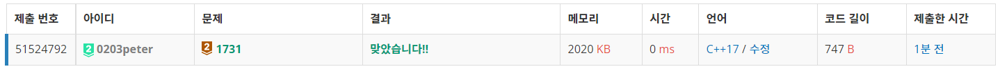

이번 주말 USACO 하고 싶었는데 다른 게 정말 많네

[https://www.acmicpc.net/problem/1731](https://www.acmicpc.net/problem/1731)

[1731번: 추론](https://www.acmicpc.net/problem/1731)



풀이

마지막 뒤 세 가지 수만 알고 있으면 된다.

두 간격의 길이가 같다면 등차수열이다. 마지막 수에 해당 간격을 더한 값을 출력한다.

아니라면 등비수열이다. 마지막 수에 해당 비율을 곱한 값을 출력한다.

시간 복잡도 : $O(N)$

소요 시간 : 1분

아쉬운 점 : 없다

전체적인 감상 : 앞의 수는 포기한다...

```cpp
/* basic setup {{{ */
#include<bits/stdc++.h>
#define ff first
#define ss second
#define pb push_back
#define sz(x) ((int)x.size())
#define all(x) x.begin(),x.end()
#define compress(x) sort(all(x)), x.erase(unique(all(x)), x.end())
#define fast_io ios_base::sync_with_stdio(0),cin.tie(0),cout.tie(0)
using namespace std;
typedef long long ll;
typedef pair<int,int> pii;
typedef pair<ll,ll> pll;
typedef const int ci;
const int MOD = 1e9+7;
const int INF = 0x3f3f3f3f;
const ll LINF = 0x3f3f3f3f3f3f3f3f;
/*}}}*/

int main(){
	fast_io;
	int n, a[3];
	cin>>n;
	for(int i=0;i<n-3;i++){
		cin>>a[0];
	}
	for(int i=0;i<3;i++){
		cin>>a[i];
	}

	if(a[0]-a[1] == a[1]-a[2]){
		cout<<a[2]+(a[2]-a[1]);
	}
	else{
		cout<<a[2]*(a[2]/a[1]);
	}
	cout<<'\n';
}
```
