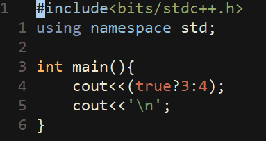
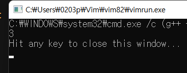
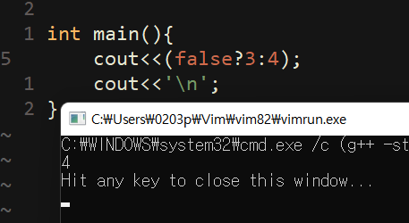

처음 알고리즘을 공부하기 시작하였을 때 다른 사람들의 코드를 읽으며 가장 알 수 없었던 부분입니다.

C++ (?)(물음표) 기호가 무엇인가요? 등의 검색을 계속했음에도 이 것을 아는 데까지는 꽤 오랜 시간이 걸렸어요.

오늘은 삼항 연산자에 대하여 아주 간단하게 소개하겠습니다.

간단히 표현하자면 삼항 연산자는

(조건) ? (참일 때 반환 결과) : (거짓일 때 반환 결과)

로 이루어 집니다.

예를 들어

이 코드의 반환 값이 예측되나요?

네 맞습니다 3이 출력되지요.

그렇다면 false일 경우에는?

예측하신 그대로입니다. 4가 출력되지요.

앞서 말씀드린 조건 자리에는 if(/\*조건\*/)에 들어가는 수식에 포함되는 것과 정확히 일치합니다.

그럼 마지막으로 하나 여쭤보겠습니다.

<b>( n > 4 ? 4 : n + 1)</b>

해당 삼항 연산자는 어떻게 작동할까요?

네 맞습니다. n이 4보다 클 경우에는 해당 삼항 연산자는 4를 return 하고 n이 4보다 작을 경우에는 (n + 1)의 결과를 반환할 것입니다.

삼항 연산자를 통해 더욱 멋있고 더욱 짧은 코드를 작성해 보세요
