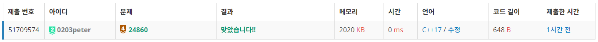

KSEF 화이팅

[https://www.acmicpc.net/problem/24860](https://www.acmicpc.net/problem/24860)

[24860번: Counting Antibodies](https://www.acmicpc.net/problem/24860)



풀이

문제를 읽는게 귀찮을 것이다.

난 설명 따로 안해주겠다.

시간 복잡도 : $O(1)$

```cpp
/* basic setup {{{ */
#include<bits/stdc++.h>
#define ff first
#define ss second
#define pb push_back
#define sz(x) ((int)x.size())
#define all(x) x.begin(),x.end()
#define compress(x) sort(all(x)), x.erase(unique(all(x)), x.end())
#define fast_io ios_base::sync_with_stdio(0),cin.tie(0),cout.tie(0)
using namespace std;
typedef long long ll;
typedef pair<int,int> pii;
typedef pair<ll,ll> pll;
typedef const int ci;
const int MOD = 1e9+7;
const int INF = 0x3f3f3f3f;
const ll LINF = 0x3f3f3f3f3f3f3f3f;
/*}}}*/

int main(){
	fast_io;
	ll aa, ab, ba, bb, ca, cb ,cc;
	cin>>aa>>ab>>ba>>bb>>ca>>cb>>cc;
	cout<<ca*cb*cc*(aa*ab + ba*bb);
	cout<<'\n';
}
```
