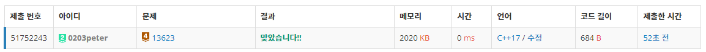

하하하 하기 싫은 일 산더미

[https://www.acmicpc.net/problem/13623](https://www.acmicpc.net/problem/13623)

[13623번: Zero or One](https://www.acmicpc.net/problem/13623)



풀이

비트논리연산을 사용하였다. 입력이 0 아님 1이기 때문에 조건문을 아주 보기 좋게 잘 적은 것 같아 기분이 좋다.

시간 복잡도 : $O(1)$

소요 시간 : 1분

아쉬운 점 : 없다 너무 잘 풀었다.

전체적인 감상 : 이 문제 너무 잘 푼 것 같다 만족스럽다.

```cpp
/* basic setup {{{ */
#include<bits/stdc++.h>
#define ff first
#define ss second
#define pb push_back
#define sz(x) ((int)x.size())
#define all(x) x.begin(),x.end()
#define compress(x) sort(all(x)), x.erase(unique(all(x)), x.end())
#define fast_io ios_base::sync_with_stdio(0),cin.tie(0),cout.tie(0)
using namespace std;
typedef long long ll;
typedef pair<int,int> pii;
typedef pair<ll,ll> pll;
typedef const int ci;
const int MOD = 1e9+7;
const int INF = 0x3f3f3f3f;
const ll LINF = 0x3f3f3f3f3f3f3f3f;
/*}}}*/

int main(){
	fast_io;
	bool a,b,c;
	cin>>a>>b>>c;
	if(a&b&c || !(a|b|c)) cout<<'*';
	else if(!(b^c)) cout<<'A';
	else if(!(a^c)) cout<<'B';
	else cout<<'C';
	cout<<'\n';
}
```
