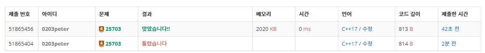

Geonworks의 스템(슬라이더)를 사보려고 한다.. 지금 청축쓰는데 더 조용한걸 원한다.

[https://www.acmicpc.net/problem/25703](https://www.acmicpc.net/problem/25703)

[25703번: 포인터 공부](https://www.acmicpc.net/problem/25703)



풀이

조건문을 많이 작성해주면 된다.

시간 복잡도 : $O(N)$

아쉬운 점 : 처음 오답은 더해주는걸 잘못했다.

전체적인 감상 : 유격없는 세상 원한다.

```cpp
/* basic setup {{{ */
#include<bits/stdc++.h>
#define ff first
#define ss second
#define pb push_back
#define sz(x) ((int)x.size())
#define all(x) x.begin(),x.end()
#define compress(x) sort(all(x)), x.erase(unique(all(x)), x.end())
#define fast_io ios_base::sync_with_stdio(0),cin.tie(0),cout.tie(0)
using namespace std;
typedef long long ll;
typedef pair<int,int> pii;
typedef pair<ll,ll> pll;
typedef const int ci;
const int MOD = 1e9+7;
const int INF = 0x3f3f3f3f;
const ll LINF = 0x3f3f3f3f3f3f3f3f;
/*}}}*/

int main(){
	fast_io;
	int n;
	cin>>n;
	cout<<"int a;\n";
	for(int i=0;i<n;i++){
		cout<<"int ";
		for(int j=0;j<=i;j++){
			cout<<'*';
		}
		cout<<"ptr";
		if(i != 0) cout<<i+1;
		cout<<" = &";
		if(i==0) cout<<"a;";
		else{
			cout<<"ptr";
			if(i!=1) cout<<i;
			cout<<';';
		}
		cout<<'\n';
	}
}
```
