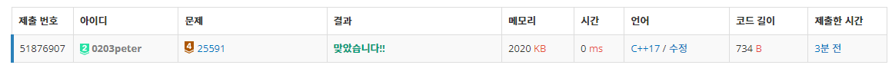

오늘은 토요일

[https://www.acmicpc.net/problem/25591](https://www.acmicpc.net/problem/25591)

[25591번: 푸앙이와 종윤이](https://www.acmicpc.net/problem/25591)



풀이

문제에서 제시되는 a, b, c, d, r, q에 대한 조건을 따라서 채워주고 출력하면 되는 문제이다.

시간 복잡도 : $O(1)$

전체적인 감상 : 그냥 읽기 싫은 문제

```cpp
/* basic setup {{{ */
#include<bits/stdc++.h>
#define ff first
#define ss second
#define pb push_back
#define sz(x) ((int)x.size())
#define all(x) x.begin(),x.end()
#define compress(x) sort(all(x)), x.erase(unique(all(x)), x.end())
#define fast_io ios_base::sync_with_stdio(0),cin.tie(0),cout.tie(0)
using namespace std;
typedef long long ll;
typedef pair<int,int> pii;
typedef pair<ll,ll> pll;
typedef const int ci;
const int MOD = 1e9+7;
const int INF = 0x3f3f3f3f;
const ll LINF = 0x3f3f3f3f3f3f3f3f;
/*}}}*/

int main(){
	fast_io;
	int p, q;
	cin>>p>>q;
	int a = 100-p, b = 100-q;
	int c = 100-(a+b), d = a*b;
	int qu = d/100, r = d%100;
	cout<<a<<' '<<b<<' '<<c<<' '<<d<<' '<<qu<<' '<<r<<'\n';
	cout<<c+qu<<' '<<r;
	cout<<'\n';
}
```
