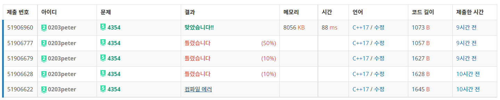

오랜만에 플래티넘 문제 풀었다. 기분 좋다.

[https://www.acmicpc.net/problem/4354](https://www.acmicpc.net/problem/4354)

[4354번: 문자열 제곱](https://www.acmicpc.net/problem/4354)



풀이

실패 함수를 활용해줘야 한다.

실패 함수를 통해 문자열이 얼마나 겹치는지 $O({s1.size()})$동안 확인해줄 수 있다.

이를 바탕으로 sz(s1)/(sz(s1)-pr) 해당 식을 통해 최대 n을 구해줄 수 있는 것이다.

50%에서 틀렸습니다가 계속 나오는 경우 소수인 펠린드롬을 고려해줬는지 다시 한번 생각해보라.

다음은 반례이다.

ABABABA

.

Correct Output :

1

시간 복잡도 : $O(T \* 10^6)$

아쉬운 점 : 문제를 처음 보고 실패 함수 쓰는 건가? 를 바로 캐치했지만 이를 구체화하는데까지 너무 오랜 시간이 걸렸다.

전체적인 감상 : 역시 어려운 문제 푸는게 기억에도 많이 남고 좋은 것 같다.

```cpp
/* basic setup {{{ */
#include<bits/stdc++.h>
#define ff first
#define ss second
#define pb push_back
#define sz(x) ((int)x.size())
#define all(x) x.begin(),x.end()
#define compress(x) sort(all(x)), x.erase(unique(all(x)), x.end())
#define fast_io ios_base::sync_with_stdio(0),cin.tie(0),cout.tie(0)
using namespace std;
typedef long long ll;
typedef pair<int,int> pii;
typedef pair<ll,ll> pll;
typedef const int ci;
const int MOD = 1e9+7;
const int INF = 0x3f3f3f3f;
const ll LINF = 0x3f3f3f3f3f3f3f3f;
/*}}}*/
vector<int> makeTable(string pattern){
  int patternSize = pattern.size();
  vector<int> table(patternSize, 0);
  int j = 0;
  for(int i=1;i<patternSize;i++){
    while(j > 0 && pattern[i] != pattern[j]){
      j = table[j-1];
    }
    if(pattern[i] == pattern[j]){
      table[i] = ++j;
    }
  }
  return table;
}
int main(){
	fast_io;
	string s1;
	// T <= 10
	// sz(s1) <= 1e6
	// kmp 하듯이?
	while(cin>>s1){
		if(s1 == ".") break;
		int pr = makeTable(s1).back();
		if(sz(s1)%(sz(s1)-pr) != 0) cout<<1<<'\n';
		else cout<<sz(s1)/(sz(s1)-pr)<<'\n';
	}
}
```
