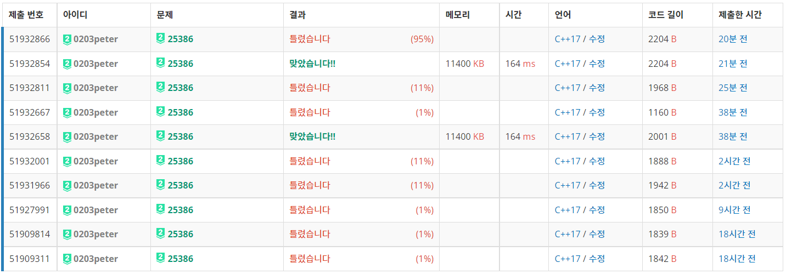

플레 2가 푸는 플레 2 문제.. 뭐가 안 맞습니다.

[https://www.acmicpc.net/problem/25386](https://www.acmicpc.net/problem/25386)

[25386번: 라즈베리 파이](https://www.acmicpc.net/problem/25386)



풀이

라즈베리(토핑)을 최소로 이동해주는 방법을 생각하기 이전에 모든 참가자의 요구를 들어줄 수 없는 경우(-1)를 먼저 생각해야 한다.

토핑은 한 번 합쳐지면 다시 나누어질 수 없기 때문에 모든 참가자들의 요구를 들어줄 수 없는 경우가 발생한다.

모든 참가자의 요구를 들어줄 수 없는 경우는 다음 세 가지로 나뉜다.

&nbsp;&nbsp;&nbsp;&nbsp;1\. 서로 다른 두 참가자가 원하는 라즈베리(토핑)이 같을 때 (61\~67 번줄)

&nbsp;&nbsp;&nbsp;&nbsp;2\. 원형 상태에서 한 명의 토핑과 파이가 있는 위치를 기준으로 선형으로 펴주고 이때 양쪽의 배열 순서가 같지 않을 때 (74\~77 번줄)

&nbsp;&nbsp;&nbsp;&nbsp;3\. 참가자의 수와 파이 조각의 수가 같을 때 (n = m) 파이 조각과 라즈베리(토핑)이 완벽히 대응된 상태로 존재하지 않는 경우 (85\~93 번줄)

배열 a과 b에 참가자가 원하는 토핑 번호와 할당받은 파이 번호를 저장해둔다.

ID를 기록해두고 토핑과 파이 번호를 기준으로 정렬해준다.

가장 작은 번호에 있는 토핑을 기준으로 그에 대응되는 ID의 파이를 찾는다.

(70\~83)

미리 설정해둔 idxa, idxb를 바탕으로 순서가 답을 찾아줄 수 있는 순서인지 확인해준다.

idxb를 기준으로 원형 상태를 직선형으로 펴준다.

직선으로 펴준 것을 기준으로 a가 b보다 작을 경우 이후 N\*M을 더할 표시를 해준다.(flag)

(95\~99)

cmp2 함수를 통해 a와 b를 정렬해준다.

더해줄 때 flag가 1인지 0인지에 따라 의미를 다르게 해석할 수 있다.

&nbsp;&nbsp;&nbsp;&nbsp;0일때 앞의 (70\~83) 코드에서 a가 b보다 작은 경우가 발생하지 않은 것이다. 그냥 모든 i에 대해 b가 a로 얼마나 접근해야하는지 더해 출력하면 된다.

&nbsp;&nbsp;&nbsp;&nbsp;1일때 앞의 코드에서 a가 b보다 작은 경우가 발생한 것이다. b가 a보다 작아 해당 한 상황 때문에 다른 모든 토핑이 한 바퀴를 돌아야 하는 것이다. 이를 ans에 N\*M을 더해주는 것으로 구현하는 것이다. 이때 a-b가 음수일 경우 N보다 덜 돌아도 원하는 목적지에 도착할 수 있음을 의미하고 a-b가 양수일 경우 N보다 더 돌아 원하는 목적지에 도착할 수 있음을 의미한다.

내가 정말 고생한 반례가 있다.

9 3

3 6 8

9 7 8

ans : 29

처음에는 48번줄에 idxb를 왜 꼭 0으로 대입해주어야하는지 이해할 수가 없었다.

결론적으로는 b(토핑)가 a(파이) 방향으로 이동하는 것이기 때문에 b의 관점에서 바라보기 위해 idxb를 가장 작은 것부터 시작하는 것이다. 78\~79번줄에 fla, flb가 체크되었을 때 m을 더해주는 구문과 100번줄에 n\*m을 더해주는 계산이 논리적이기 위해서는 b가 a방향으로 가면서 a가 b 뒤에 있다고 판단해도 되는건지 정확히 알 수 있도록 해준다.

시간 복잡도 : $O(n \\log n)$

아쉬운 점 : 맞왜틀을 너무 많이했다. 맞왜틀을 많이 한게 잘한 것 같기도 하다.

감상 :

정말 재밌게 푼 문제 같다. 어제 새벽 2시 반까지 정말 오랜 시간동안 풀었다. 처음 풀기 시작할 때는 이렇게 될 줄 몰랐는데...

```cpp
/* basic setup {{{ */
#include<bits/stdc++.h>
#define ff first
#define ss second
#define pb push_back
#define sz(x) ((int)x.size())
#define all(x) x.begin(),x.end()
#define compress(x) sort(all(x)), x.erase(unique(all(x)), x.end())
#define fast_io ios_base::sync_with_stdio(0),cin.tie(0),cout.tie(0)
using namespace std;
typedef long long ll;
typedef pair<int,int> pii;
typedef pair<ll,ll> pll;
typedef const int ci;
const int MOD = 1e9+7;
const int INF = 0x3f3f3f3f;
const ll LINF = 0x3f3f3f3f3f3f3f3f;
/*}}}*/
ll n, m;
ll ans = 0; // 출력할 최소 이동 횟수
int idxa, idxb;
// idxa = a[i].ss가 0일때의 i (ff 기준 정렬 이후)
// idxb = b[i].ss가 0일때의 i (ff 기준 정렬 이후)
vector<pll> a, b;
// a[i].ff = a[i].ss번째 참가자가 원하는 파이 번호
// b[i].ff = b[i].ss번째 참가자가 원하는 파이 번호

bool cmp2(pll l, pll r){ // id순 정렬 함수
	return l.ss < r.ss;
}

int main(){
	fast_io;
	cin>>m>>n;
	a.resize(n);
	b.resize(n);
	for(int i=0;i<n;i++) cin>>a[i].ff;
	for(int i=0;i<n;i++) cin>>b[i].ff;
	for(int i=0;i<n;i++){
		// id 배정
		a[i].ss = i;
		b[i].ss = i;
	}
	sort(all(a));
	sort(all(b));

	// idxb가 0부터 시작해야되는 이유?
	idxb = 0;
	int chker = b[idxb].ss;
	for(int i=0;i<n;i++){
		if(a[i].ss == chker){
			idxa = i;
			break;
		}
	}

	// idxa와 idxb를 임의로 지정해주면 안되고
	// idxb가 0이 되는 위치에 맞추어 idxa도 함께 설정해주어야한다
	// 그 이유는 무엇인가?

	for(int i=0;i<n-1;i++){
		// 원하는 토핑이 같을 경우 실패
		if(b[i].ff == b[i+1].ff){
			cout<<-1<<'\n';
			return 0;
		}
	}

	bool fla = 0, flb = 0, flag = 0;
	for(int i=0; i<n; i++, idxa++, idxb++){
		if(idxa == n) idxa = 0, fla = 1;
		if(idxb == n) idxb = 0, flb = 1;

		if(a[idxa].ss != b[idxb].ss){
			cout<<-1<<'\n';
			return 0;
		}
		if(fla) a[idxa].ff += m;
		if(flb) b[idxb].ff += m;
		if(a[idxa].ff < b[idxb].ff){
			flag = 1;
		}
	}

	if(n == m){
		if(a[0].ff == b[0].ff){
			cout<<0<<'\n';
		}
		else{
			cout<<-1<<'\n';
		}
		return 0;
	}

	sort(all(a), cmp2);
	sort(all(b), cmp2);
	for(int i=0;i<n;i++){
		ans += a[i].ff - b[i].ff;
	}
	if(flag) ans += n*m;
	cout<<ans;
	cout<<'\n';
}
```
