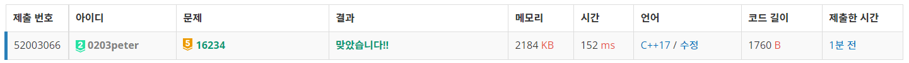

플레 5 풀다가 너무 무서워져서 골드 5로 내려왔다. 편안.

[https://www.acmicpc.net/problem/16234](https://www.acmicpc.net/problem/16234)

[16234번: 인구 이동](https://www.acmicpc.net/problem/16234)



풀이

매번 연결해주고 연결 정보를 vector v로 관리해주고 초기화해주고 하며 교환이 발생하지 않을 때까지 이를 반복해준다.

시간 복잡도 : $O(2000\*N^2)$

감상 :

처음에 많이 해맸다.

일찍이부터 그냥 bfs 써서 했으면 편하게 했을걸 괜히 엄한 방법으로 하려다 시간만 많이 썼다. 아쉽다.

```cpp
/* basic setup {{{ */
#include<bits/stdc++.h>
#define ff first
#define ss second
#define pb push_back
#define sz(x) ((int)x.size())
#define all(x) x.begin(),x.end()
#define compress(x) sort(all(x)), x.erase(unique(all(x)), x.end())
#define fast_io ios_base::sync_with_stdio(0),cin.tie(0),cout.tie(0)
using namespace std;
typedef long long ll;
typedef pair<int,int> pii;
typedef pair<ll,ll> pll;
typedef const int ci;
const int MOD = 1e9+7;
const int INF = 0x3f3f3f3f;
const ll LINF = 0x3f3f3f3f3f3f3f3f;
/*}}}*/
ci BN = 51;
int n, a[BN][BN], l, r, m[BN][BN], q, dx[] = {0,0,-1,1}, dy[] = {1,-1,0,0};
bool chk[BN][BN];
bool inr(int x, int y){
	return x >= 0 && x < n && y >= 0 && y < n;
}

int main(){
	fast_io;
	cin>>n>>l>>r;
	for(int i=0;i<n;i++){
		for(int j=0;j<n;j++){
			cin>>a[i][j];
		}
	}
	int ans = 0;
	bool flag;
	while(1){
		memset(chk, 0, sizeof chk);
		memset(m, -1, sizeof m);
		queue<pii> q;
		vector<pii> v;
		flag = 0;

		for(int i=0;i<n;i++){
			for(int j=0;j<n;j++){
				if(chk[i][j]) continue;
				q.push({i, j});
				chk[i][j] = 1;
				m[i][j] = sz(v);

				int ttl = a[i][j], cn = 1;
				while(!q.empty()){
					pii fr = q.front();
					q.pop();

					for(int k=0;k<4;k++){
						int cx = fr.ff + dx[k], cy = fr.ss + dy[k];
						if(inr(cx, cy)){
							if(!chk[cx][cy]&&abs(a[fr.ff][fr.ss] - a[cx][cy]) >= l && abs(a[fr.ff][fr.ss] - a[cx][cy]) <= r){
								flag = 1;
								q.push({cx, cy});
								chk[cx][cy] = 1;
								m[cx][cy] = sz(v);
								ttl += a[cx][cy];
								cn++;
							}
						}
					}
				}
				v.pb({ttl, cn});
			}
		}

		for(int i=0;i<n;i++){
			for(int j=0;j<n;j++){
				if(m[i][j] != -1){
					a[i][j] = v[m[i][j]].ff/v[m[i][j]].ss;
				}
			}
		}

		if(!flag) break;
		ans++;
	}
	cout<<ans;
	cout<<'\n';
}
```
