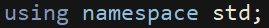
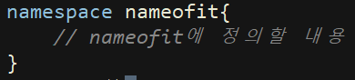

글 제목이 다소 자극적으로 보일 수 있어서 결론부터 말씀드리겠습니다.

 using namespace std는 저희가 짜는 코드(PS)에는 매우매우매우매우 안전합니다. 

C++을 통해 PS 코드를 작성하게 될 때 꽤 많은 사람들이 겪는 현상이 있습니다.

using namespace std; 가 어떤 기능을 하는지도 모른 채 이를 사용하는 것입니다.

물론 using namespace std;의 역할 기능을 필수적으로 알아야 하는 것은 아니지만

매일같이 작성하시는 이 코드를 이해함으로써 만약 추후 작성하실 코드에 오류가 발생하신다면 이에 대해 빠르게 대처할 수 있고 이 코드를 이해한다는 사실만으로 더욱 행복해질 수 있기 때문에 이번 기회에 알아가시면 좋을 것 같습니다.

본격적으로 위험성에 대하여 소개해드리기 전에

이 코드에 대해 이해해봅시다.

이 코드를 한글로 표현한다면?

"std라는 이름의 namespace를 사용한다"

이 문장 그대로 해당 코드는 std라는 namespace를 이용할 것을 명시합니다.

/\* std는 standard의 약자를 의미합니다 \*/

그럼 namespace가 뭘까요? 이름 공간? 이름 공간이면 이름을 저장해놓는 곳인가?

이번에도 정확하셨습니다.  

namespace는 함수명, 변수명을 해당 함수, 변수의 기능, 설정값과 함께 저장해놓는 곳입니다.

그럼 이제 아실 수 있으실 겁니다. 뭐를요? 저 코드의 기능을요.

std라는 이름을 가지고 있는 네임스페이스 속의 함수, 변수들을 선언 범위 내에서 사용하겠다는 의미를 가집니다.

// 여기서 해당 범위는 변수 선언을 하였을 때 해당 변수가 영향을 미치는 범위와 같습니다  

그럼 이제는 완전히 이해하실 수 있으실 거 같습니다.

아! cin, cout이라는 기능을 하는 요소들이 std라는 namespace 안에 선언되어있었구나!

맞습니다 정확히 이해하셨습니다.

그럼 오늘의 진짜 주제에 대해 이야기해보겠습니다.

사람들은 왜 using namespace std가 위험하다고 하는 걸까요?

개발을 하다 보면 기본 제공 std namespace 외에도

의 구조로 namespace를 사용자가 정의하여 사용하게 됩니다.

&nbsp;지금까지 말씀드린 부분을 통해 아실 수 있듯이 개발하는 데에 있어 우려되는 부분은 이렇게 만들어놓은 namespace와 std속의 요소의 이름이 일치하여 충돌이 일어나는 상황입니다.

그럼 자연스럽게 이 글의 제목이었던 PS를 하는데에 있어 using namespace std의 위험성에 대한 대답도 아실 수 있으실 겁니다.

일반적으로 PS를 하며 namespace를 사용하는 경우는 많이 없기 때문에 using namespace std를 사용함으로써 충돌이 발생할 것에 대한 걱정은 하지 않으셔도 되는 겁니다.

그럼에도 여전히 변수명이나 함수명이 std namespace 내부의 내용과 중복되는 경우 충돌이 발생하기 때문에 이러한 점에 대하여는 주의해주셔야 합니다.

추가적으로 걱정하실 수도 있는 부분인 성능 저하 문제도 using namespace std를 통해 발생하지 않으니 걱정하지 마시고 편하게 사용하시면 됩니다.

역시, 모두들 아시는 것과 같이 이러한 위험성은 저희가 짧게 다루는 PS(Problem Solving) 코드에는 완전히 무해합니다.

이 글을 통해 using namespace std의 정확한 용도와 주의해야 할 점을 알 수 있으셨으면 좋겠습니다.
