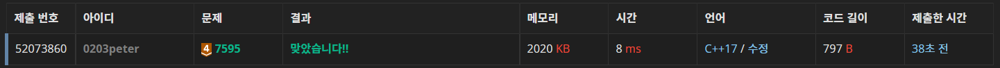

큐빙 맞왜틀.. 이건 말이 안된다 반례를 찾았는데도 모르겠다.

[https://www.acmicpc.net/problem/7595](https://www.acmicpc.net/problem/7595)

[7595번: Triangles](https://www.acmicpc.net/problem/7595)



풀이

별찍기를 여러번 해주면 된다.  별찍기는 어렵지 않게 구현 할 수 있다.

시간 복잡도 : $O(N^2)$

감상 : 대한민국 카타르 월드컵 화이팅 !!!

```cpp
/* basic setup {{{ */
#include<bits/stdc++.h>
#define ff first
#define ss second
#define pb push_back
#define sz(x) ((int)x.size())
#define all(x) x.begin(),x.end()
#define compress(x) sort(all(x)), x.erase(unique(all(x)), x.end())
#define fast_io ios_base::sync_with_stdio(0),cin.tie(0),cout.tie(0)
#define FOR(i,a,b) for(int i=(a);i<(b);++i)
#define ROF(i,a,b) for (int i=(b)-1;i>=(a);--i)
#define R0F(i,a) ROF(i,0,a)
#define trav(a,x) for (auto& a: x)
using namespace std;
typedef long long ll;
typedef pair<int,int> pii;
typedef pair<ll,ll> pll;
typedef const int ci;
const int MOD = 1e9+7;
const int INF = 0x3f3f3f3f;
const ll LINF = 0x3f3f3f3f3f3f3f3f;
/*}}}*/

int main(){
	fast_io;
	int n;
	while(cin>>n){
		if(n==0) break;
		FOR(i,0,n){
			FOR(j,0,i+1) cout<<'*';
			cout<<'\n';
		}
	}
}
```
