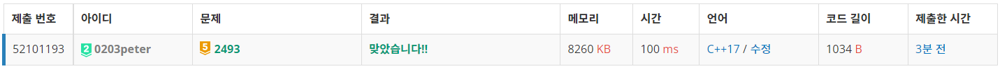

내일 아티스틱 스위밍 대회한다. 많이 기대된다.

[https://www.acmicpc.net/problem/2493](https://www.acmicpc.net/problem/2493)

[2493번: 탑](https://www.acmicpc.net/problem/2493)



풀이

stack을 사용해 해결해줄 수 있는 문제이다. 특정 위치에 있어서 해당 위치 이전에 있는 탑들이 현재 위치에 있는 탑들보다 작을 경우 이후의 탑들에서 해당 작은 탑들에 도달할 수 있는 방법은 없다. 이 원리를 이용해 한번 탐색해준 탑은 사용하거나 제거해줄 수 있는 것이다. (시간 복잡도 $O(N)$)

감상

이제 이런 문제들은 쉽게 풀린다. 보람이 있다.

```cpp
/* basic setup {{{ */
#include<bits/stdc++.h>
#define ff first
#define ss second
#define pb push_back
#define sz(x) ((int)x.size())
#define all(x) x.begin(),x.end()
#define compress(x) sort(all(x)), x.erase(unique(all(x)), x.end())
#define fast_io ios_base::sync_with_stdio(0),cin.tie(0),cout.tie(0)
#define FOR(i,a,b) for(int i=(a);i<(b);++i)
#define F0R(i,a) FOR(i,0,a)
#define ROF(i,a,b) for (int i=(b)-1;i>=(a);--i)
#define R0F(i,a) ROF(i,0,a)
#define trav(a,x) for (auto& a: x)
using namespace std;
typedef long long ll;
typedef pair<int,int> pii;
typedef pair<ll,ll> pll;
typedef const int ci;
const int MOD = 1e9+7;
const int INF = 0x3f3f3f3f;
const ll LINF = 0x3f3f3f3f3f3f3f3f;
/*}}}*/
int n;
vector<int> v;
int main(){
	fast_io;
	cin>>n;
	v.resize(n);
	for(int i=0;i<n;i++){
		cin>>v[i];
	}
	stack<pii> s;
	for(int i=0;i<n;i++){
		while(!s.empty() && s.top().ff < v[i]){
			s.pop();
		}
		if(s.empty()){
			s.push({v[i],i});
			cout<<0<<' ';
			continue;
		}
		cout<<s.top().ss+1<<' ';
		s.push({v[i],i});
	}

	cout<<'\n';
}
```
