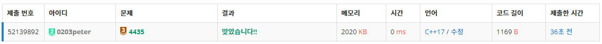

1일 1블로그

[https://www.acmicpc.net/problem/4435](https://www.acmicpc.net/problem/4435)

[4435번: 중간계 전쟁](https://www.acmicpc.net/problem/4435)



풀이

문제에서 제시된 조건에 맞추어 weighted sum을 구해 비교해주면 되는 문제이다

시간 복잡도 :  $O(T)$

감상 : 오늘의 아티스틱 스위밍 대회 즐거웠다.

```cpp
/* basic setup {{{ */
#include<bits/stdc++.h>
#define ff first
#define ss second
#define pb push_back
#define sz(x) ((int)x.size())
#define all(x) x.begin(),x.end()
#define compress(x) sort(all(x)), x.erase(unique(all(x)), x.end())
#define fast_io ios_base::sync_with_stdio(0),cin.tie(0),cout.tie(0)
#define FOR(i,a,b) for(int i=(a);i<(b);++i)
#define F0R(i,a) FOR(i,0,a)
#define ROF(i,a,b) for (int i=(b)-1;i>=(a);--i)
#define R0F(i,a) ROF(i,0,a)
#define trav(a,x) for (auto& a: x)
using namespace std;
typedef long long ll;
typedef pair<int,int> pii;
typedef pair<ll,ll> pll;
typedef const int ci;
const int MOD = 1e9+7;
const int INF = 0x3f3f3f3f;
const ll LINF = 0x3f3f3f3f3f3f3f3f;
/*}}}*/

int main(){
	fast_io;
	int t;
	cin>>t;
	int i = 0;
	while(t--){
		cout<<"Battle "<<++i<<": ";
		int a[6], b[7];
		for(int i=0;i<6;i++) cin>>a[i];
		for(int i=0;i<7;i++) cin>>b[i];
		int sa =0, sb =0;
		sa += a[0]+a[1]*2+a[2]*3+a[3]*3+a[4]*4+a[5]*10;
		sb += b[0]+2*(b[1]+b[2]+b[3])+3*b[4]+5*b[5]+10*b[6];
		if(sa == sb) cout<<"No victor on this battle field\n";
		else if(sa > sb) cout<<"Good triumphs over Evil\n";
		else cout<<"Evil eradicates all trace of Good\n";
	}
}
```
