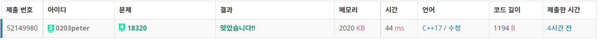

훈련을 지배하라

[https://www.acmicpc.net/problem/18320](https://www.acmicpc.net/problem/18320)

[18320번: Loan Repayment](https://www.acmicpc.net/problem/18320)



풀이

매개변수 이분 탐색을 통한 풀이이다.

동일한 y에 대한 연산을 한 번에 진행해준다.

이 문제의 핵심은 x의 정확한 의미를 파악하는 것이다. x는 현재 남아있는 구간들을 몇 개로 나누어 주었는지를 의미하는 수이다.

전체 남아있는 구간에 대해 현재의 y(소수점 버림)으로 제할 수 있는 일수를 확인하고 한번에 처리해주는 것이다.

floor((N-G)(남아있는 돈) / X(몇 개의 구간으로 나눌지)) = Y

시간 복잡도 : $O(\\sqrt{N}\*\\log{N})$

감상 : 유익하게 잘 푼 문제이다.

```cpp
/* basic setup {{{ */
#include<bits/stdc++.h>
#define ff first
#define ss second
#define pb push_back
#define sz(x) ((int)x.size())
#define all(x) x.begin(),x.end()
#define compress(x) sort(all(x)), x.erase(unique(all(x)), x.end())
#define fast_io ios_base::sync_with_stdio(0),cin.tie(0),cout.tie(0)
#define FOR(i,a,b) for(int i=(a);i<(b);++i)
#define F0R(i,a) FOR(i,0,a)
#define ROF(i,a,b) for (int i=(b)-1;i>=(a);--i)
#define R0F(i,a) ROF(i,0,a)
#define trav(a,x) for (auto& a: x)
using namespace std;
typedef long long ll;
typedef pair<int,int> pii;
typedef pair<ll,ll> pll;
typedef const int ci;
const int MOD = 1e9+7;
const int INF = 0x3f3f3f3f;
const ll LINF = 0x3f3f3f3f3f3f3f3f;
/*}}}*/
ll n, k, m;

bool valid(ll x){
	ll tn = n, tk = k;

	while(tn > 0 && tk > 0){
		ll y = tn / x;
		if(y <= m){
			ll leftday = (tn-1)/m+1;
			return leftday <= tk;
		}
		ll days = (tn-x*y-1)/y+1;
		if(days > tk) days = tk;
		tn -= y * days;
		tk -= days;
	}
	return tn <= 0;
}

int main(){
	fast_io;
	cin>>n>>k>>m;

	ll lhs = 1, rhs = 1e12, ans;

	while(lhs <= rhs){
		ll mid = (lhs+rhs)>>1;
		if(valid(mid)){
			ans = mid;
			lhs = mid+1;
		}
		else{
			rhs = mid-1;
		}
	}
	cout<<ans;
	cout<<'\n';
}
```
