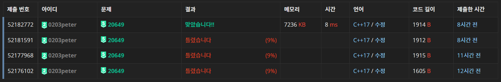

힘내자

[https://www.acmicpc.net/problem/20649](https://www.acmicpc.net/problem/20649)

[20649번: Stuck in a Rut](https://www.acmicpc.net/problem/20649)



풀이

ecow, ncow를 구분해주고 사건 정리 및 정렬 후 처리를 진행해준다.

```cpp
/* basic setup {{{ */
#include<bits/stdc++.h>
#define ff first
#define ss second
#define pb push_back
#define sz(x) ((int)x.size())
#define all(x) x.begin(),x.end()
#define compress(x) sort(all(x)), x.erase(unique(all(x)), x.end())
#define fast_io ios_base::sync_with_stdio(0),cin.tie(0),cout.tie(0)
#define FOR(i,a,b) for(int i=(a);i<(b);++i)
#define F0R(i,a) FOR(i,0,a)
#define ROF(i,a,b) for (int i=(b)-1;i>=(a);--i)
#define R0F(i,a) ROF(i,0,a)
#define trav(a,x) for (auto& a: x)
using namespace std;
typedef long long ll;
typedef pair<int,int> pii;
typedef pair<ll,ll> pll;
typedef const int ci;
const int MOD = 1e9+7;
const int INF = 0x3f3f3f3f;
const ll LINF = 0x3f3f3f3f3f3f3f3f;
/*}}}*/
struct cow{
	int x, y, id;
};
struct eve{
	int t, gen, diec, blamc;
};
ci BN = 1e5+1;
int n, ans[BN];
int chk[BN], par[BN];
vector<cow> ncow, ecow;
vector<eve> event;
vector<int> chd[BN];
void init(){
	cin>>n;
	F0R(i, n){
		char c; int a, b; cin>>c>>a>>b;
		if(c == 'N') ncow.pb({a, b, i});
		else ecow.pb({a, b, i});
	}
}
int pe = 0;
void dps(int cur){
	int st = ++pe;
	for(int nx : chd[cur]){
		dps(nx);
	}
	ans[cur] = pe-st;
}
void pro(){
	for(int i=0;i<sz(ncow);i++){
		for(int j=0;j<sz(ecow);j++){
			if(ecow[j].x < ncow[i].x && ecow[j].y > ncow[i].y){
				int d1 = ncow[i].x - ecow[j].x, d2 = ecow[j].y-ncow[i].y;
				if(d1 == d2) continue;
				if(d1 > d2){
					event.pb({d1, d2, ecow[j].id, ncow[i].id});
				}
				else{
					event.pb({d2, d1, ncow[i].id, ecow[j].id});
				}
			}
		}
	}
	sort(all(event), [](eve l, eve r){ return l.t < r.t; });
	memset(par, -1, sizeof par);
	memset(chk, 0x3f, sizeof chk);
	for(eve f : event){
		if(chk[f.diec] != INF || f.gen > chk[f.blamc]) continue;
		chd[f.blamc].pb(f.diec);
		par[f.diec] = f.blamc;
		chk[f.diec] = f.t;
	}

	for(int i=0;i<n;i++){
		if(par[i] == -1){
			dps(i);
		}
	}

	for(int i=0;i<n;i++) cout<<ans[i]<<'\n';
}
int main(){
	fast_io;
	init();
	pro();
}
```
