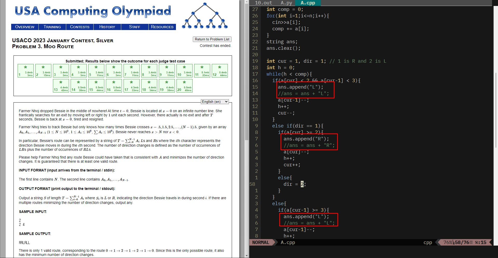
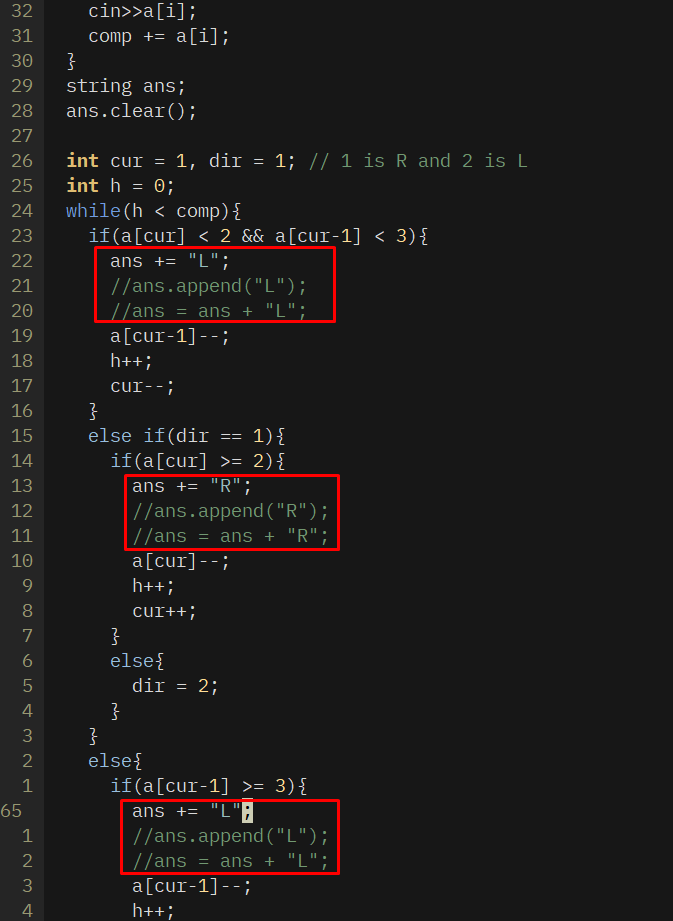

2023년 1월 USACO 응시 중에 문자열 덧셈을 아래와 같은 형식으로 해주었다.

```cpp
ex = ex + "R";
```

코드의 시간복잡도에는 이상이 없었지만 계속 시간초과가 나오는걸 보고 내가 완전히 헷갈리고있는게 있나보다 생각했다.

결국 테케 절반을 TLE로 날리고 solution을 확인해보니 내 코드와 다를 바 없는 정답 코드를 보고 이상함을 느끼게 되었고 시험시 제출하였던 상단과 같은 코드만 바꾸어주니.....



바로 정답이 나오는 것 아니겠는가....



+= 도 append와 비슷한 속도다

```cpp
ans = ans + "R";
```

위와 같은 구조가 느린 속도를 보이는 이유는 "새로운 문자열을 생성하여" 기존의 ans에 대입하기 때문이다.

뭐 어쩔 수 없다. 이제라도 알았으니 된거다
