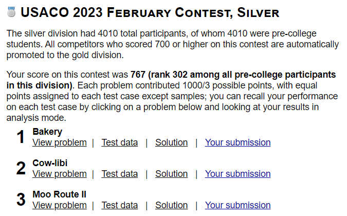

2021년 12월에 USACO bronze를 취득한 이후로 여섯번의 silver 시험을 봤다.

차례로 714/1000 (750 커트), 67/1000 (650), 0/1000 (800), 378/1000 (750), 420/1000 (700), <u><b>767/1000 (700)</b></u>

제일 잘 본 두 시험이 처음 본 시험과 합격한 시험이라는게 신기하다.

심지어 이번에 본 것도 방학동안 코딩 거의 안하고 알 수 없는 자신감에 기분좋게 봤는데 잘 통과했다.

역시 그냥 마음편하게 보는게 성적이 잘 나오는 것 같다.

