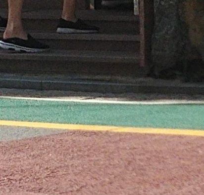

내가 초등학교를 다닐 때까지는 인간의 창작능력만큼은 인공지능이 따라올 수 없다는 주장이 주를 이루었다. 이런 이유로 미래에도 사라지지 않을 직업 하면 먼저 떠오르는 것은 역시 작가, 화가 같은 예술 관련 직업이었다. 어느 순간부터 인공지능이 뮤직비디오 감독역할을 했다는 소식이 들리는가 하면 요즘에는 인공지능의 그림이 입상을 했다는 소식까지 들린다. 여전히 인공지능의 창작은 아직이라고 생각한다. 하지만 그 간극이 계속해 좁혀지고 있는 건 사실이다. 인간의 창작능력이 인공지능에 의해 계속 도전받고 있는 상황 속에  인간의 창작능력은 과연 무엇인지 고민해 보았다. 인간이나 기계나 둘 다 입력받아 출력하는 모습은 똑같은데 다른점이 뭐지?

무언가 새로운 걸 만들어내는 것을 창작으로 생각해 보자. 누군가 새로운 행동을 했다. 어떻게, 왜 새로운 행동을 했을까? 생각해 보면 그 사람의 어린 시절, 주변환경이 그 기저에 깔려있다. 이러한 정보들이 기계학습의 데이터셋에 포함되는 것들과 무슨 차이가 나는 걸까? 다양성의 차이다. 물론 인공지능이 지금까지의 창작이 일어났던 과정의 경향을 학습해 인간과 같이 앞으로의 창작을 할 수 있을 것이라고 생각할 수 있다. 하지만 시대가 변함에 따라 창작이 일어나는 대상, 형태, 그리고 과정이 함께 변한다. 중요한 부분은 오감에서 오는 정말 풍부한 범위의 입력이라고 생각한다. 시각, 청각, 후각, 미각, 그리고 촉각의 종합적인 정보가 인간에게 입력되고 누군가는 이러한 정보들을 조합하여 새롭게 보이는 행동들을 하는 거다. 인공지능이 인간의 창작 즉 새로운 걸 만들어낸다고 하는 영역을 모방하기 위해서는 이러한 인간이 느끼는 감각을 입력으로 해야 한다. 밥 한 숟가락 더 먹었을 때 배불러지는 그 차이를, 한 시간 더 앉아있어 허리가 아파지는 그 차이를, 인간이 일상 속에서 느끼는 미세한 차이를 입력으로 할 수 있어야 한다. 이 풍부한 범위의 입력을 학습시켰을 때 그 누구도 인간의 그것과 구분할 수 없는 인공지능의 창작을 얻을 수 있지 않을까?
