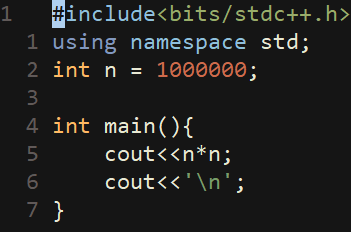
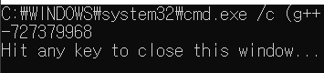
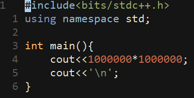
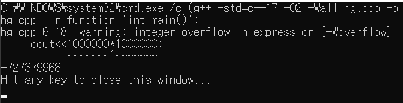
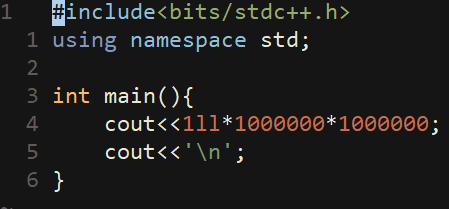
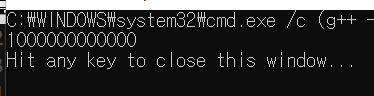
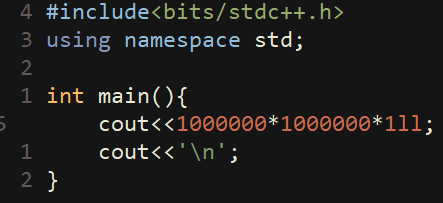
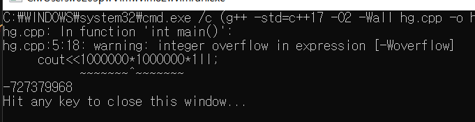

Codeforces의 editorial을 보면 자주 나오는 요소가 있다. 바로 1LL(1ll)이다.

1ll이 어떠한 역할을 하는 걸까? 알아보도록 하자.

위 코드의 출력은 무엇일까?

*1번 코드*

*1번 코드 출력값*

전혀 예측할 수 없는 값이 나온다. int형으로 선언된 변수 n의 범위를 벗어나 overflow가 발생한 것이다.

// int는 32비트를 사용하는 변수이다.

그렇다면 이 코드의 출력은 어떻게 될까?

*2번 코드*

*2번 코드 출력값*

컴파일러가 warning 해주는 그대로이다.

C++에서는 기본 연산을 int(-2^31+1 \~ 2^31-1) 내에서 진행한다.

따라서 1번 코드와 똑같은 Integer overflow가 발생하는 것이다.

이쯤에서 1ll이 무엇인지 어떤 역할을 하는지 설명해보도록 하겠다.

1ll을 '1'과 'll'로 두 개로 쪼갤 수 있다.

앞의 1 은 숫자 1을 나타낸다. 뒤의 ll은 long long int의 형태(64비트)로 사용할 것을 의미한다.

따라서 1ll은 "숫자 1을 long long int의 자료형을 통해 나타내겠습니다."를 의미한다.

C++에서는 하나의 계산식에 대해서 계산 우선순위에 따라 계산을 하며 가장 범위 또는 정밀도가 큰 자료형에 맞추어 계산식의 범위를 할당한다.

이러한 점에서 우리는 본격적인 계산식이 시작되기 전에 해당 계산식에 1ll을 곱해줌으로써 해당 계산식의 범위는

int에서 long long int로 바뀌게 되고 이를 통해 Integer overflow를 예방할 수 있는 것이다.

예제를 통해 이해를 확실히 해보자.

*3번 코드*

*3번 코드 출력값*

이전의 코드들과는 다르게 계산이 시작되기 전에 1ll을 곱해주었기 때문에 overflow가 발생하지 않고 정상적인 출력 값을 반환하는 것을 볼 수 있다.

마지막으로 하나의 코드를 더 보여주겠다. 이 코드를 통해 계산 우선순위의 중요성을 느낄 수 있을 것이다.

*4번 코드*

*4번 코드 출력값*

\* 연산의 우선순위인 좌 -> 우 에 따라서 1ll이 곱해지기 전에 int 자료형의 형태로 10^6 \* 10^6의 연산이 진행되었다.

따라서 Integer overflow가 발생하게 되었고 뒤에 1ll이 곱해지긴 했지만 overflow 발생 이후의 시점이니 의미가 없어지는 것이다.

1ll을 사용함으로서 귀찮은 과정을 더욱 단축시킬 수 있기를 바란다.
