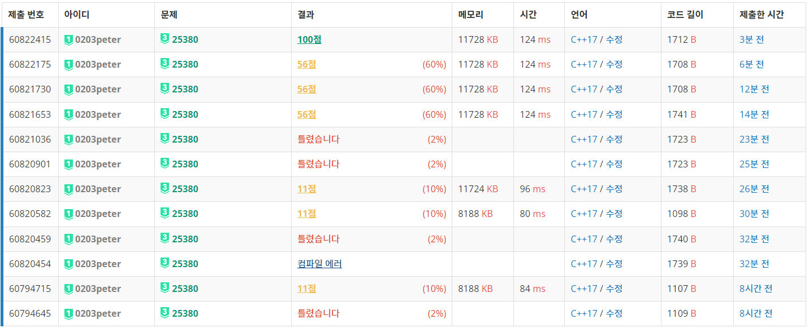

KOI 2022 중등부 1차 2번 문제이다.

[https://www.acmicpc.net/problem/25380](https://www.acmicpc.net/problem/25380)

[25380번: 커다란 도시](https://www.acmicpc.net/problem/25380)



풀이

섭테별로 의미하는 바가 다르다.

[공식해설](https://koi.or.kr/koi/2022/1/)을 많이 참고한 풀이이다.

이분탐색을 사용하라는 부분은 도저히 이해가 안되더라 그냥 새로 생각해서 풀었다.

시간 복잡도 : $O({N}\\log{N})$

감상 : 드디어 정올 1차 붙었다. 너무 기쁘다. 조만간 후기 하나 올려야겠다.

```cpp
#include<bits/stdc++.h>
#define ff first
#define ss second
#define pb push_back
#define sz(x) ((int)x.size())
#define all(x) x.begin(),x.end()
#define compress(x) sort(all(x)), x.erase(unique(all(x)), x.end())
#define fast_io ios_base::sync_with_stdio(0),cin.tie(0),cout.tie(0)
#define FOR(i,a,b) for(int i=(a);i<(b);++i)
#define F0R(i,a) FOR(i,0,a)
#define ROF(i,a,b) for (int i=(b)-1;i>=(a);--i)
#define R0F(i,a) ROF(i,0,a)
#define trav(a,x) for (auto& a: x)
using namespace std;
typedef long long ll;
typedef pair<int,int> pii;
typedef pair<ll,ll> pll;
typedef const int ci;
const int MOD = 1e9+7;
const int INF = 0x3f3f3f3f;
const ll LINF = 0x3f3f3f3f3f3f3f3f;

ll gty(vector<ll> dot, vector<ll> lne){
  ll ret = 0;

  lne.push_back(-INF);
  lne.push_back(INF);

  sort(all(dot));
  sort(all(lne));

  ll taxi = 0;
  // just taxi distance
  for(int i=0;i<sz(dot);i++){
    taxi += dot[i]*(i-(sz(dot)-i-1));
  }
  ret += taxi;

  int idx = 0;

  for(int i=1;i<sz(lne);i++){
    int ld = lne[i-1], rd = lne[i];
    vector<int> cur, cdis;
    // current section to give offset about taxi
    while(idx < sz(dot) && dot[idx] <= rd){
      cur.push_back(dot[idx++]);
    }

    if(sz(cur) == 0) continue;

    for(int nw : cur){
      cdis.push_back(min(nw-ld, rd-nw));
    }

    sort(all(cdis));

    for(int j=0;j<sz(cdis);j++){
      ret += 1ll*cdis[j]*2*(sz(cdis)-j-1);
    }
  }
  return ret;
}

int main(){
  fast_io;
  int n,m,k;
  cin>>n>>m>>k;
  vector<ll> vn(n), vm(m);
  for(ll &i : vn) cin>>i;
  for(ll &i : vm) cin>>i;
  vector<ll> vx, vy;
  for(int i=0;i<k;i++){
    int a, b;
    cin>>a>>b;
    vx.pb(a);
    vy.pb(b);
  }

  ll ans = 0;
  ans += gty(vx, vn);
  ans += gty(vy, vm);
  cout<<ans;
}
```
