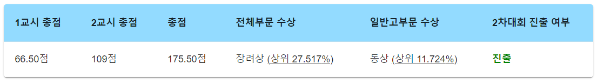
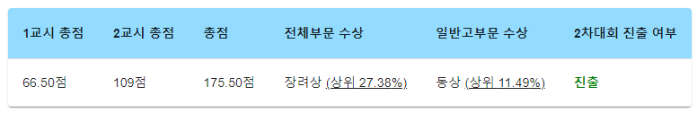

1교시나 2교시 문제에 대한 이야기는 일절 안할거다.  

5/14일 한국정보올림피아드 1차 응시하고 너무 우울했다.  
2교시에서 못해도 200점은 받아야 안전하게 본선 갈 수 있을거라고 생각했다.  
1번은 보자마자 코드적고 AC 받았지만 2번 문제 보고 깜!짝! 놀랐다.  
결국 섭테도 제대로 못긁고 2교시를 109점으로 마무리했다.  
이건 무조건 똑떨이라고 생각했다.  
바로 다음날에 가채점 결과가 나왔다.  
결과 나왔다는 소식을 확인하자마자 분노부터 치밀어오르더라.  
옆에 앉아있던 친구에게 미안한 마음 뿐이다.  
그래도 결과는 확인해야지 싶었다.

*가채점결과는 이랬는데*

*최종결과는 이렇다. 부정행위로 별이되어버린 내위몇명에게 심심한 심심을 전한다.*

어이고  
오락가락끼릭가락  
야호  
왓업  

결과를 보자마자 머릿속에 수많은 생각이 스쳤다.  
일반고부문 동상이라니 온몸에 전율이 흘렀다.  
2차대회가 너무 하고싶었는데 드디어 할 수 있겠구나  
2021년 중등부 1차 장려상 똑떨..  
2022년 고등부 1차 장려상 똑떨..  
2023년은 다르구나! 드디어 본선에 가는구나!  

7/15일까지 가능한 많이 성장했을때  
2023 고등부 CMS 점수판에 내 이름이 어디에 꽂힐지 너무 기대된다.  
다들 지켜보라고.
