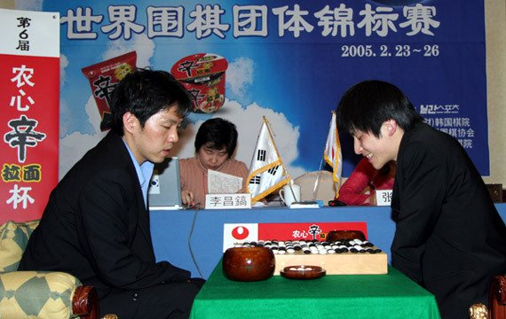

하라주쿠 안녕? 오늘 내가 너에게 갔어 재밌더라 예쁘고 즐거워 크레페 많이 먹더라? 그렇게 맛있나? 외국인도 많고 명품입은사람도 이곳저곳. 유명인사를 만나고도 뒤만 밟았다. 즐거운 사람들 예쁜, 도시가 화려했어. 노트북 스티커도 두개 샀다. 이렇게 생기가 넘쳐보이는 도시는 사람을 괜히 기분좋게한다.

이케부쿠로 반가워. 이케부쿠로에 있는 프린스 호텔에 벌써 3일째 묵고있다. 이케부쿠로 또한 북적북적 했다. 익숙하지 않은 곳에 오니 오전 5시 30분부터 한시간동안 동네를 산책했다. 우리 동네 부천시에서도 이렇게 일찍 걸어본적이 없는데. 짧은 시간동안 많이 보고싶은 욕심이다. 게시판이 많더라, 유료 주차장도 작게작게 많이 있고, 고즈넉한 동네 분위기, 새벽시간이 주는 유쾌함 다 좋더라.

'이창호의 부득탐승'에서 이창호 九단은 붉은 여왕 가설에 대해 이야기한다. 자신의 승률 하락을 묻는 기자들에게 나는 분명히 나의 전성기때보다 기력이 향상했다고 단지 바둑 프로 전체의 기력이 상향 평준화되어서, 이렇게 성장한 폭이 내가 성장한 폭보다 커서 내가 앞으로 걸었는지와는 관계없이 나는 남들보다 뒤에 있게된거라고.

이케부쿠로도 분명히 계속 화려해져왔다. 화려한 곳을 평균의 사람들이 보고 쾌락을 느끼는 곳이라고 한다면, 이를 절대 부정할 수 없다. 주변 환경, 하라주쿠가 너무 큰 폭으로 화려해져서 덜 그렇게 보이는 것 뿐이다.

이케부쿠로도 나름의 화려함을 가졌다. 하라주쿠가 너무 화려한 것 뿐이다.

스스로만 성장했다면 주변이 어떻게 변화하는지는 신경쓰지 않아도 되나? 상대적인 우위에 서게된게 아니라면 좋게 평가할 수 없는건가?
