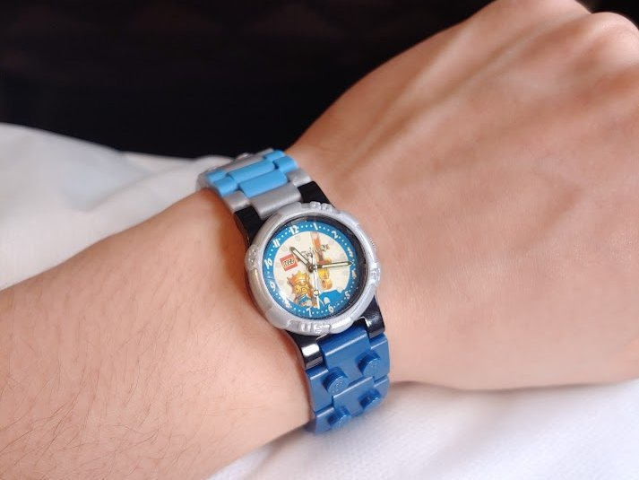

*Bust down Iced out Watch*

모든건 사건이 시작한 순간 결정되었다. 지금의 나는 어제의 내가 한 행동에 따라 행동하고 어제의 나는 그제의 내가 한 행동에 따라 행동한다. 태어난 순간부터 오늘의 내가 무엇을 할지 결정되어있었다는거다. 외부의 영향 또한 이렇게 과거의 변화에 따라 구성되었으니 나와 외부의 상호작용도 이미 모두 결정된 상태이다. 내가 이 사실을 알고 무력감에 빠질지 무던히 받아들일지도 이미 모두 결정되어있다. 이 글을 쓴 나를 본 당신이 "내용도 없으면서 깨달은체 하고싶어 안달났네" 라고 생각할지 모든게 모든것이 시작한 순간부터 결정되어있었음을 느낄지도 이미 결정되어있다. 바둑에는 필연의 수순이라는 개념이 있다. 흑과 백이 주고받을 모습이 이미 결정되어있다는 것이다. 우리 인생이 그렇다. 주변인이 아무리 듣기싫은 말을 해도 보기싫은 행동을 해도 이 모두 필연의 수순이다. 따라서 이러한 주변을 보고 열을 올릴필요가 없다고 생각한다. 내 뜻을 확실히 전달하겠다는 의미의 표현을 할 수는 있지만 스스로 분노할 필요는 없다.

14살때 Determinism에 대해 처음 이해하고 한동안 굉장한 무기력에 빠졌었던 기억이 있다. 그렇다.
