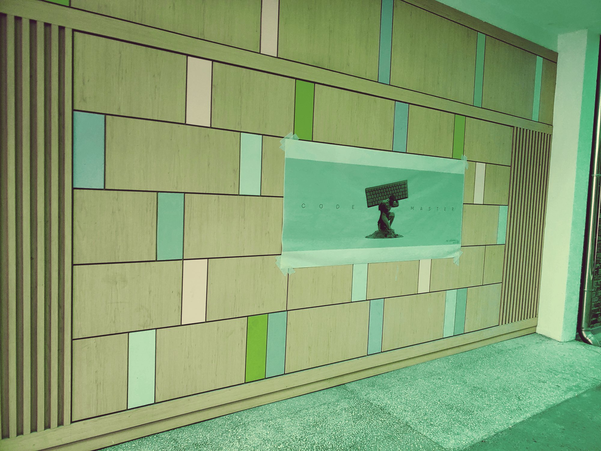
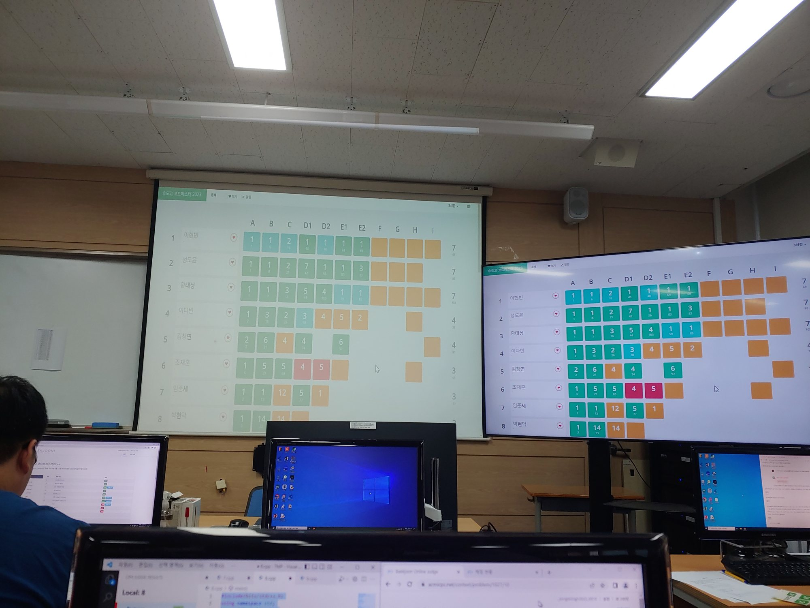
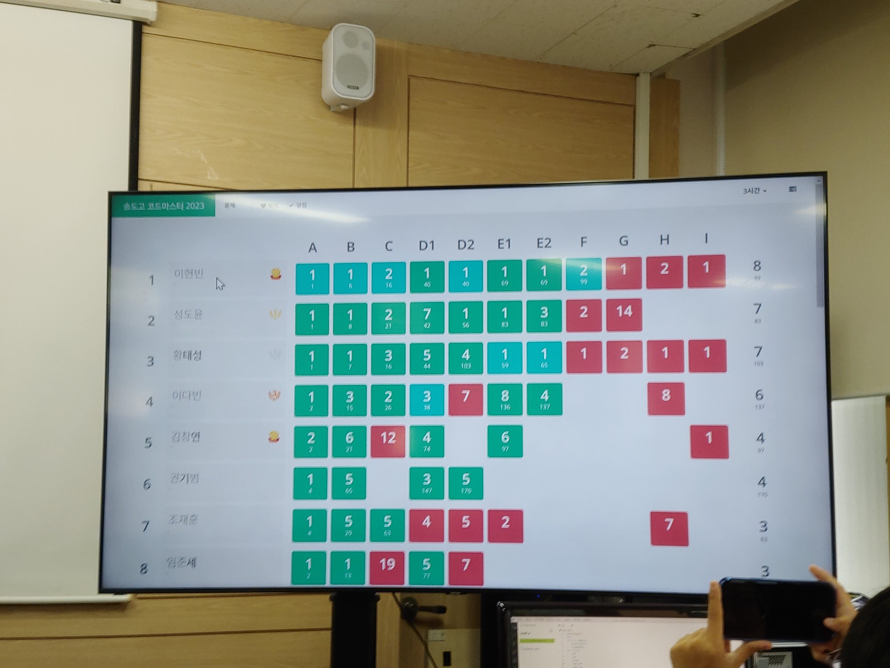
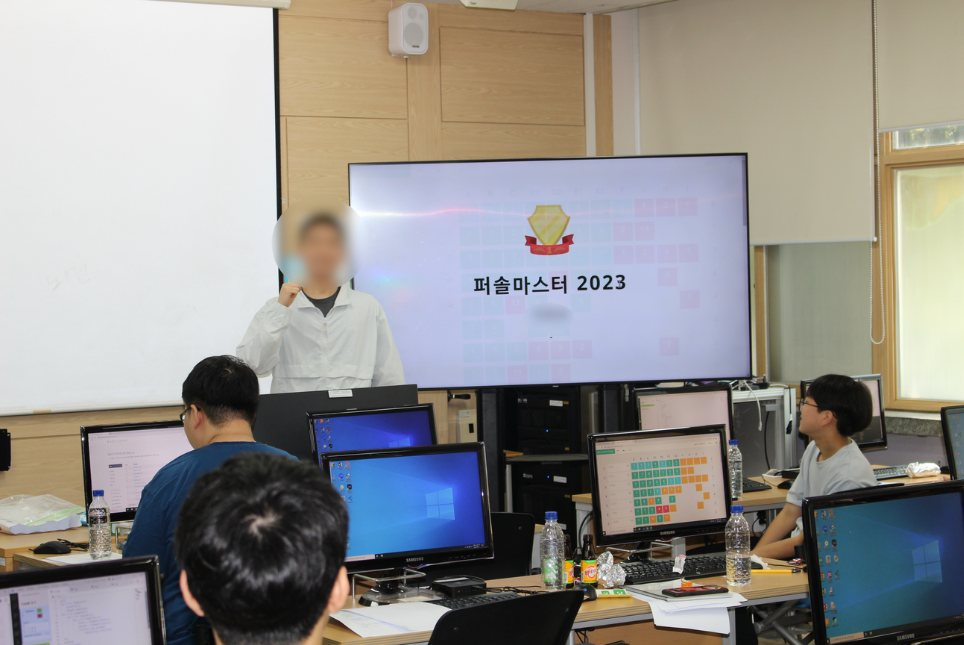
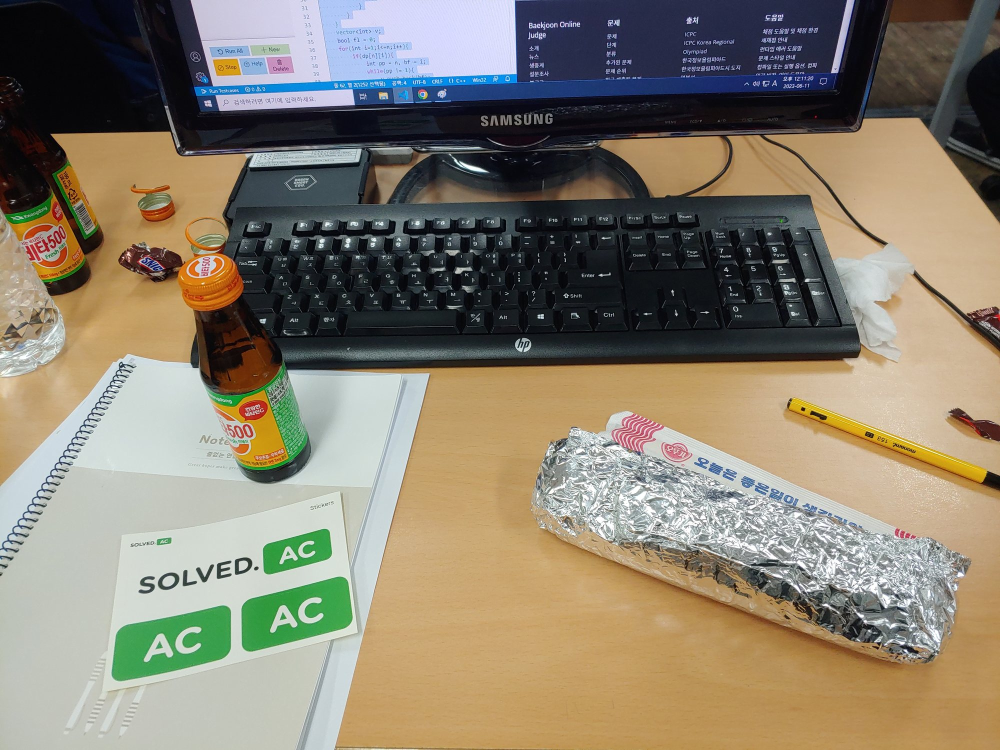

친한 형이 인천 중고등학생을 대상으로 하는 대회를 개최한다는 소식을 들었다. 청심국제고등학교에 재학 중인 나는 아쉽게도 경기도에 속하는 학생이라 시상에 해당되지 않았지만 너그러운 2023 코드마스터 운영에 오프라인 대회에 참가할 수 있는 기회가 있었다. 6월 11일 아침 대회 참가를 위해 집(부천) 근처에 사는 친구와 함께 송도고등학교에 방문했다. 대회에 참여하지도 않았는데 함께 동행해 준 친구에게 고맙다. 오전 8시 30분에 입실하여 제공되는 개발 환경을 확인하고 노트, 필기구를 꺼내 시험을 준비했다. 개발 환경으로는 c++17, VSC, cph extension 이 제공되었다 (다른 언어는 어떻게 되었는지 모르겠음). 평소 vim과 여러 key remapping(caps -> esc, ctrl -> alt, alt -> ctrl)을 사용하는 이상한 취향이 있어 익숙하지 않은 환경이 조금 우려되었지만 그래도 PS는 노트랑 펜으로 하는 거라는 생각에 크게 신경 쓰지 않았다. 운영진의 간단한 인사말과 개발 환경에 대한 소개가 마무리된 후 오전 9시 5분 새들의 지저귐과 함께 대회가 시작되었다.

문제 목록은 여기서 확인이 가능하다.

[https://www.acmicpc.net/category/detail/3608](https://www.acmicpc.net/category/detail/3608)

<b>+1 min</b>

A 문제 코드마스터 2023 First Solve!

간단한 입출력 문제였다. 바로 코드를 작성했고 제출했다.

<details>
<summary>더보기</summary>

```cpp
#include<bits/stdc++.h>
using namespace std;

int main(){
	cin.tie(0)->sync_with_stdio(0);
	string s1;
	cin>>s1;

	if(s1 == "SONGDO") cout<<"HIGHSCHOOL";
	if(s1 == "CODE") cout<<"MASTER";
	if(s1 == "2023") cout<<"0611";
	if(s1 == "ALGORITHM") cout<<"CONTEST";

}
```

</details>

<b>+6 min</b>

B 점심시간 레이스 First Solve!

거리 비교 문제였다. 바로 작성하고 제출했다.

<details>
<summary>더보기</summary>

```cpp
#include<bits/stdc++.h>
using namespace std;
typedef pair<int,int> pii;
int n, m, k;
vector<pii> v;

int main(){
    cin.tie(0)->sync_with_stdio(0);
    cin>>n>>m>>k;
    int dis = 111111111;
    int ans = -1;
    for(int i=0;i<k;i++){
        int f, d;
        cin>>f>>d;
        int cd = f+m-d;
        if(dis > cd){
            dis = cd;
            ans = i+1;
        }
    }
    cout<<ans;

}
```

</details>

<b>+16 min</b>

C 정보 선생님의 야망 First Solve!

다섯 개의 요일 중 두 요일을 골라($5 \\choose 2$) 수강 가능한 학생 수를 체크하고 이 중 최댓값을 출력하는 문제이다.

백트래킹을 통해 5개 중 2개를 골라주었는데 지금 돌이켜보면 왜 이리 짰나 싶다. 이중 for문으로 간단히 해결될 것을..

<details>
<summary>더보기</summary>

```cpp
#include<bits/stdc++.h>
using namespace std;
const int BN = 1e6+10;
int ar[BN][12], n, ck;
int aa[10] = {1,1,0,0,0};
bool chk[BN];
int ans = 0;

void goo(){
    int ck = 0;
    for(int i=0;i<n;i++){
        bool fc = 0;
        for(int j=0;j<5;j++){
            if(chk[j] && !ar[i][j]) fc = 1;
        }
        if(!fc) ck++;
    }
    if(ck > ans){
        ans = ck;
        for(int i=0;i<5;i++) aa[i] = chk[i];
    }
    return;
}
void bctr(int idx){
    if(idx == 5){
        int cc = 0;
        for(int i=0;i<5;i++){
            if(chk[i]) cc++;
        }
        if(cc == 2){
            goo();
        }
        return;
    }
    chk[idx] = 1;
    bctr(idx+1);
    chk[idx] = 0;
    bctr(idx+1);
}

int main(){
    cin.tie(0)->sync_with_stdio(0);
    cin>>n;
    for(int i=0;i<n;i++){
        for(int j=0;j<5;j++){
            cin>>ar[i][j];
        }
    }
    bctr(0);
    cout<<ans<<'\n';
    for(int i=0;i<5;i++) cout<<aa[i]<<' ';
}
```

</details>

<b>+38 min</b>

D1 정답기록이 스코어보드로 올라왔다. 퍼솔을 놓쳤다는 약간의 아쉬움이 들었다.

<b>+40 min</b>

D2 배고파(Hard) First Solve! & D1 배고파(Easy) Accepted!

Easy는 Hard가 안 풀리면 풀 생각으로 건너뛰었다.

$2^{x} + 2^{y} = m$ 에서 제공되는 x, y 범위가 충분히 작아 모든 m 후보를 정렬된 상태로 저장해 두었다. 이후 쿼리를 받을 때마다 이진탐색을 하며 가장 가까운 m을 출력했다.

<details>
<summary>더보기</summary>

```cpp
#include<bits/stdc++.h>
using namespace std;
typedef long long ll;
typedef tuple<ll, int, int> ti;
const int BN = 20;
int n;
vector<ti> an;

int main(){
    cin.tie(0)->sync_with_stdio(0);
    cin>>n;

    for(ll i=0;i<=61;i++){
        for(ll j=i;j<=61;j++){
            ll aa = 1ll<<i;
            ll bb = 1ll<<j;
            an.push_back({aa+bb, i, j});
        }
    }
    sort(an.begin(), an.end());

    for(int i=0;i<n;i++){
        ll q;
        cin>>q;
        ti tmp = {q, 0, 0};
        int kk = lower_bound(an.begin(), an.end(), tmp) - an.begin();
        int cq = kk - 1;
        if(cq >= 0){
            auto[ma, xa, ya] = an[kk];
            auto[mb, xb, yb] = an[cq];
            if(abs(mb-q) <= abs(ma-q)){
                cout<<xb<<' '<<yb<<'\n';
            }
            else{
                cout<<xa<<' '<<ya<<'\n';
            }
        }
        else{
            cout<<0<<' '<<0<<'\n';
        }
    }

}
```

</details>

<b>+69 min</b>

E2 수학 선생님의 고민(Hard) Accepted! & E1 수학 선생님의 고민(Easy) Accepted!

D와 마찬가지로 Easy는 Hard가 안 풀리면 풀 생각으로 건너뛰었다.

$n\*x^{2}+(n+1)\*x^{1}-(n+2) = (ax + b)(cx + d)$ 일 때 n이 주어졌을 때 a, b, c, d를 구하는 문제였다.

식을 전개하고 보면 쉽다.

$n = a\*c$ : a, c의 후보군은 $\\sqrt{n}$개 이하이다.

$n+2 = -b\*d$ : b, d의 후보군은 $\\sqrt{n+2}$개 이하이다.

시간복잡도 : $O(\\sqrt{n}\*\\sqrt{n})$

<details>
<summary>더보기</summary>

```cpp
#include<bits/stdc++.h>
using namespace std;
typedef long long ll;
typedef pair<ll,ll> pl;
ll n;
vector<pl> va, vb;

int main(){
    cin.tie(0)->sync_with_stdio(0);
    cin>>n;

    for(ll i=1;i*i<=n;i++){
        if(n % i == 0){
            ll f = i;
            ll s = n/i;
            va.push_back({f, s});
        }
    }
    for(ll i=1;i*i<=(n+2);i++){
        if((n+2) % i == 0){
            ll f = i;
            ll s = (n+2)/i;
            vb.push_back({f, s});
        }
    }
    for(int i=0;i<va.size();i++){
        for(int j=0;j<vb.size();j++){
            ll a = va[i].first, c = va[i].second, b = vb[j].first, d = vb[j].second;
            assert(a*c == n);
            assert(b*d == n+2);
            if(a*d - b*c == n+1){
                cout<<a<<' '<<-b<<' '<<c<<' '<<d<<'\n';
                return 0;
            }
            if(b*c - a*d == n+1){
                cout<<a<<' '<<b<<' '<<c<<' '<<-d<<'\n';
                return 0;  
            }
            swap(a, c);
            if(a*d - b*c == n+1){
                cout<<a<<   ' '<<-b<<' '<<c<<' '<<d<<'\n';
                return 0;
            }
            if(b*c - a*d == n+1){
                cout<<a<<' '<<b<<' '<<c<<' '<<-d<<'\n';
                return 0;  
            }

        }
    }

    cout<<-1;
}
```

</details>

<b>+99 min</b>

F S리그 First Solve!

다양한 테스트케이스를 만들어보고 그림을 그려보며 직사각형 모양에 한 묶음은 오른쪽에서 편하게 처리하고 다른 한 팀은 오른쪽이나 왼쪽으로 한 칸씩 밀어주면 쉽게 풀리겠다는 생각이 들었다. 기울기 이슈로 첫 제출이 WA가 나왔다. 34, 38번 줄에 -10을 추가해 주니 해당 사항이 해결되어 정답이 나왔다. (치밀한 데이터셋을 몸으로 느끼고 대회의 퀄리티에 감동했다)

<details>
<summary>더보기</summary>

```cpp
#include<bits/stdc++.h>
using namespace std;
const int BN = 5010;
int n, a[4], an[BN][2];

int main(){
    cin.tie(0)->sync_with_stdio(0);
    cin>>n;
    for(int i=0;i<4;i++) cin>>a[i];

    int b1 = a[0], b2 = a[1];

    an[b1][0] = 1e8;
    an[b2][0] = 1e8;

    if(b1 < b2){
        an[b1][1] = 1e8;
        an[b2][1] = 0;
    }
    else{
        an[b1][1] = 0;
        an[b2][1] = 1e8;
    }
    int l = min(b1, b2), r = max(b1, b2);

    int f = 1e8;

    for(int i=l+1;i<r;i++){
        an[i][0] = f-1;
        an[i][1] = an[i-1][1]-1;
    }
    int bf = -1;
    for(int i=r+1;i<=n;i++){
        an[i][0] = -f-10;
        an[i][1] = ++bf;
    }
    for(int i=1;i<l;i++){
        an[i][0] = -f-10;
        an[i][1] = ++bf;
    }

    int ff = a[2], ss = a[3];

    if(l < ff && ff < r){
        an[ff][0]--;
    }
    else{
        an[ff][0]++;
    }
    if(l < ss && ss < r){
        an[ss][0]--;
    }
    else{
        an[ss][0]++;
    }

    for(int i=1;i<=n;i++) cout<<an[i][0]<<' '<<an[i][1]<<'\n';
}
```

</details>

<b>+100\~180 min</b>

G를 보고 감이 안 잡혀서 H로 넘어갔다.

H에서 잘못된 관찰을 해서 이를 구현하고 반례를 찾는데에 남은 시간을 사용했지만 이후에 변동 없이 8솔로 대회를 마무리했다.


*두명의 경쟁자를 견제하기 위한 몇차례의 블러핑 제출... 당시에는 확인도 못했지만 지금 다시보니 앞에 계신 분 정답/오답까지 찍혔네..*

오전 12시 5분 대회가 마무리되고 김밥을 먹으며 잠시 분위기를 환기하는 시간이 있었다. 대회가 끝나자마자 뒤에 여러 사람이 문제에 대해 이야기를 나누는 모습을 보며 많은 사람들이 즐길 수 있는 문제들이었다는 생각이 들었다. 시간이 조금 지나고 스코어보드 프리즈를 오픈하는 시간을 가졌다. 7솔로 프리즈를 마무리한 다른 두 분과 함께 긴장하며 흥미진진한 운영진의 해설과 함께 결과를 확인하였다.



감사하게도 1등으로 마무리할 수 있었다.

본 시상에는 포함되지 않았지만 8개중 5개의 퍼솔을 하며 퍼솔마스터 특별상을 받아 기분이 좋았다.



추신



-   첫 오프라인 대회 참여였다. 스코어보드가 대회장 앞에서 실시간으로 수정되는 게 꽤 압박되었다.
-   비타500을 매우 좋아한다. 대회 중 참가자에게 비타500이 제공되어서 자제하지 못하고 네 병이나 마셔버렸다.
-   solved.ac 스티커를 받았다. 노트북 뒤에 붙였는데 너무 마음에 든다.
-   사악한 역슬래쉬 위치에(컴퓨터실 국룰) 코딩하면서 정신이 어질어질했다.
-   cph가 생각보다 엄청 편하더라. 출력값 읽기도 편하고 standard error 따로 나오고 컴파일&실행도 빠르고..
-   과학관, 국제관 등으로 나뉜 큰 건물들, 작게 꾸며진 물레방아, 깔끔하고 광활한 화장실을 보고 송도고등학교는 꽤 멋진 학교라고 생각했다.
-   PS에 익숙하지 않은 사람부터 재미있게 즐기고 있는 사람까지 모두 아우르는 훌륭한 대회였다.
